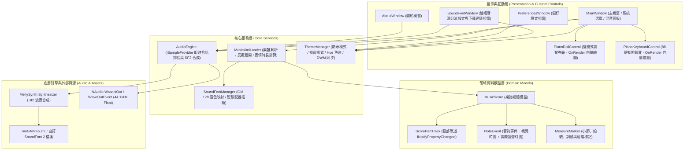
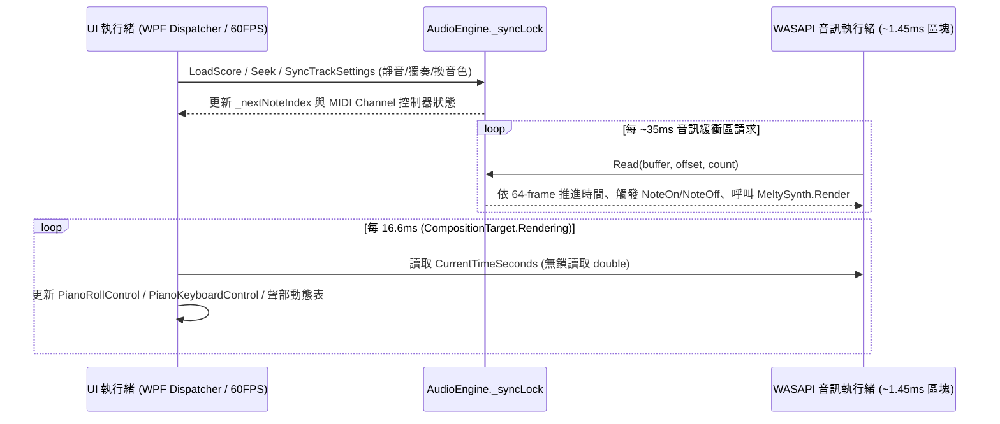

# 系統架構與技術文件 (Architecture & Technical Documentation)

本文件說明 **Windows MusicXML 真實音源播放器 (WinMusicXmlPlayer)** 的整體技術架構、核心模組職責、即時音訊合成管線與 60FPS 視覺渲染同步機制。

---

## 1. 技術棧 (Technology Stack)

| 層級 | 採用技術 / 框架 | 版本 / 規格 | 用途說明 |
| :--- | :--- | :--- | :--- |
| **應用框架** | .NET / WPF (Windows Presentation Foundation) | .NET 8.0 (`net8.0-windows`) | 桌面 UI 框架、硬體加速向量繪圖 (`DrawingContext`) 與資源管理 |
| **高 DPI 支援** | PerMonitorV2 | Windows 10/11 原生 | 跨螢幕不同縮放比例下的文字與線條像素級清晰度 (`PixelsPerDip`) |
| **波表合成器** | MeltySynth | 2.1.0 | 純 C# SoundFont 2 (`.sf2`) 即時波表合成、128 複音、Reverb / Chorus 效果器 |
| **音訊輸出層** | NAudio (`WasapiOut` / `WaveOutEvent`) | 2.2.1 | 44.1 kHz、32-bit IEEE Float 雙聲道低延遲共享模式音訊串流 |
| **樂譜解析** | `System.Xml.Linq` (`XDocument`) + `ZipArchive` | .NET 8 內建 | 解析 `.musicxml`、`.xml` 與壓縮容器 `.mxl` |
| **原生視窗整合** | Windows DWM API (`dwmapi.dll`) | Win32 P/Invoke | 動態控制原生標題列深淺色、標題列背景色、邊框色與視窗圓角策略 |

---

## 2. 系統分層架構圖

---

## 3. 核心模組職責說明

### 3.1 `Services/MusicXmlLoader.cs` — 樂譜解析與時間軸編譯器
- **支援格式**：自動辨識一般 XML (`.musicxml` / `.xml`) 與 ZIP 封裝之 `.mxl`（解析 `META-INF/container.xml` 定位主譜檔）。
- **反覆與房號展開機 (`BuildPlaybackSequence`)**：掃描小節中的 `<repeat direction="forward/backward"/>` 與 `<ending number="1/2" type="start/stop/discontinue"/>`，建構展開後的線性播放小節序列。
- **多聲部智慧拆分**：當單一 Part 包含多個譜表（如鋼琴高音譜表 `staff=1` 與低音譜表 `staff=2`）或同譜表多聲部旋律時，自動拆分為獨立的 `ScorePartTrack` 並分配獨立 MIDI Channel（跳過 Channel 9 鼓組通道）。
- **演奏表情與裝飾音合成**：將斷奏（Staccato）、跳音（Staccatissimo）、保持音（Tenuto）、連音線（Tie）、圓滑線（Slur）、琶音（Arpeggiate）與裝飾音（Trill、Mordent、Turn、Grace Note）轉換為精確的 `NoteEvent` 序列。

### 3.2 `Services/AudioEngine.cs` — 低延遲雙槽分流音訊合成引擎
- 實作 NAudio 的 `ISampleProvider` 介面，輸出格式固定為 **44,100 Hz / 2 Channels / IEEE 32-bit Float**。
- **雙合成器路由與同步混音 (Dual-Synthesizer Routing & Mixing)**：
  - 內部維護兩套獨立的 `MeltySynth.Synthesizer`：通用樂器合成器 `_synth` 與鋼琴專用合成器 `_pianoSynth`。
  - 當使用者載入鋼琴專用 `.sf2` 音源時，所有 `GmProgram` 屬於 `0..5`（鋼琴家族）的聲部自動路由至 `_pianoSynth`，其餘樂器路由至 `_synth`；並具備智慧 Preset 映射（`ResolvePresetForSoundFont`），自動相容僅含單一 Preset (`Bank 0, Patch 0`) 的高階鋼琴音源。
- **64-Frame 微區塊排程 (Sub-block Sample-Accurate Scheduling)**：
  - 在 `Read(float[] buffer, int offset, int count)` 音訊執行緒迴圈中，每次以 **64 frames（約 1.45 ms）** 為單位推進時間 `_currentTimeSec`。
  - 先掃描 `_activeNotes` 佇列，將到達 `AudioEndTimeSeconds` 的音符向其所屬合成器準時送出 `NoteOff`；再以指標 `_nextNoteIndex` 觸發進入時間區間的新音符 `NoteOn`。
  - 同步呼叫 `_synth.Render(...)` 與 `_pianoSynth.Render(...)` 產生左右聲道浮點取樣並進行立體聲疊加與防爆音處理，確保音符觸發精準度達毫秒等級，無 Timer 抖動（Jitter）。
- **低延遲輸出策略**：優先初始化 `WasapiOut(AudioClientShareMode.Shared, useEventSync: true, latency: 35ms)`；若環境不支援則自動降級至 `WaveOutEvent(DesiredLatency = 55ms)`。

### 3.3 `Controls/PianoRollControl.cs` & `PianoKeyboardControl.cs` — 硬體加速向量繪圖
- 兩者皆直接繼承自 `FrameworkElement` 並覆寫 `OnRender(DrawingContext dc)`，避免傳統 WPF 為數千個音符建立 `Border` / `Rectangle` 視覺樹節點所造成的記憶體暴增與 Layout 卡頓。
- **`O(log N)` 二分搜尋視窗裁剪 (`FindFirstNoteIndexBefore`)**：
  - 樂譜總音符數可達數千至數萬顆；每次 `OnRender` 時透過二分搜尋在 `O(log N)` 時間內定位目前可見時間視窗（`viewStartSec` ~ `viewEndSec`）的起始音符索引，僅繪製畫面可見範圍內的音符。
- **60FPS 畫面同步迴圈**：由 `MainWindow` 訂閱 `CompositionTarget.Rendering` 事件，在每一垂直同步幀讀取 `_audioEngine.CurrentTimeSeconds`，同步刷新鋼琴卷軸、88 鍵鋼琴、時間軸拉桿、小節/調號/BPM 狀態與各聲部動態音量表。

### 3.4 `Services/ThemeManager.cs` — 即時動態主題與原生 DWM 整合
- 集中管理 `DisplayMode`（系統 / 淺色 / 深色）、`WindowStyle`（現代圓潤 / 專業俐落 / 主題炫彩 / 古典音樂廳）與 `CurrentHue`（`0°` ~ `360°` HSL 色彩空間轉換）。
- 變更設定時即時更新 `Application.Current.Resources` 中的所有 `SolidColorBrush` 與 `CornerRadius` 動態資源，並透過 Win32 `DwmSetWindowAttribute` 同步更新所有視窗的原生標題列與邊框色彩。

---

## 4. 執行緒模型與併發安全 (Threading & Concurrency)

- **鎖保護範圍**：所有對 `MeltySynth.Synthesizer`、`_activeNotes` 清單與 `_nextNoteIndex` 的讀寫皆封裝於 `AudioEngine._syncLock` 互斥鎖內，確保在播放途中拖曳時間軸（Seek）、切換靜音/獨奏或更換樂器音色時絕對不會發生 Race Condition 或懸空音（Hanging Notes）。
