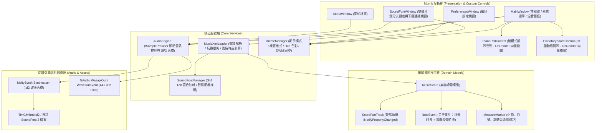
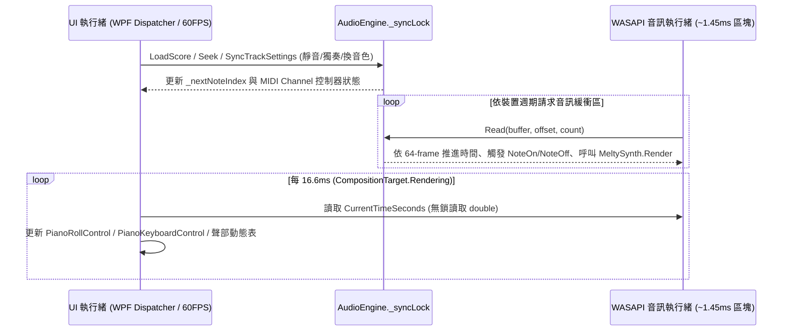

# 系統架構與技術文件 (Architecture & Technical Documentation)

本文件說明 **Windows MusicXML 真實音源播放器 (WinMusicXmlPlayer)** 的整體技術架構、核心模組職責、即時音訊合成管線與 60FPS 視覺渲染同步機制。

---

## 1. 技術棧 (Technology Stack)

| 層級 | 採用技術 / 框架 | 版本 / 規格 | 用途說明 |
| :--- | :--- | :--- | :--- |
| **應用框架** | .NET / WPF (Windows Presentation Foundation) | .NET 8.0 (`net8.0-windows`) | 桌面 UI 框架、硬體加速向量繪圖 (`DrawingContext`) 與資源管理 |
| **高 DPI 支援** | PerMonitorV2 | Windows 10/11 原生 | 跨螢幕不同縮放比例下的文字與線條像素級清晰度 (`PixelsPerDip`) |
| **波表合成器** | MeltySynth（內嵌原始碼） | 2.4.1 | 純 C# SoundFont 2 (`.sf2`) 即時波表合成、128 複音、Reverb / Chorus 效果器 |
| **音訊輸出層** | NAudio (`WasapiOut` / `WaveOutEvent`) | 2.2.1 | 44.1 kHz、32-bit IEEE Float 雙聲道低延遲共享模式音訊串流 |
| **樂譜解析** | `System.Xml.Linq` (`XDocument`) + `ZipArchive` | .NET 8 內建 | 解析 `.musicxml`、`.xml` 與壓縮容器 `.mxl` |
| **原生視窗整合** | Windows DWM API (`dwmapi.dll`) | Win32 P/Invoke | 動態控制原生標題列深淺色、標題列背景色、邊框色與視窗圓角策略 |

---

## 2. 系統分層架構圖

---

## 3. 核心模組職責說明

### 3.1 `Services/MusicXmlLoader.cs` — 樂譜解析與時間軸編譯器
- **支援格式**：自動辨識一般 XML (`.musicxml` / `.xml`) 與 ZIP 封裝之 `.mxl`（解析 `META-INF/container.xml` 定位主譜檔）。
- **反覆與房號展開機 (`BuildPlaybackSequence`)**：掃描小節中的 `<repeat direction="forward/backward"/>` 與 `<ending number="1/2" type="start/stop/discontinue"/>`，建構展開後的線性播放小節序列。
- **多聲部智慧拆分**：當單一 Part 包含多個譜表（如鋼琴高音譜表 `staff=1` 與低音譜表 `staff=2`）或同譜表多聲部旋律時，自動拆分為獨立的 `ScorePartTrack` 並分配獨立 MIDI Channel（跳過 Channel 9 鼓組通道）。
- **演奏表情與裝飾音合成**：將斷奏（Staccato）、跳音（Staccatissimo）、保持音（Tenuto）、連音線（Tie）、圓滑線（Slur）、琶音（Arpeggiate）與裝飾音（Trill、Mordent、Turn、Grace Note）轉換為精確的 `NoteEvent` 序列。
- **演奏表情管線 (Performance Pipeline)**：
  - 解析 `<arpeggiate direction="up/down">`，依方向與速度展開琶音。
  - 解析 `<breath-mark>`／`<caesura>`，以 `MeasureMeta.Pauses` 建立呼吸停頓，並在 `MeasureMarker.BeatLineTimes` 保存實際拍線時間。
  - 無明確踏板的鋼琴聲部可依低音／和聲變化建立隱式踏板區間。
  - 套用 `PerformanceOptions`：人性化微時序／力度、力度曲線、動態範圍，以及弦樂／管樂的 CC1 顫音自動化點（`MusicScore.ModulationPointsByChannel`）。

### 3.2 `Services/AudioEngine.cs` — 低延遲雙槽分流音訊合成引擎
- 實作 NAudio 的 `ISampleProvider` 介面，輸出格式固定為 **44,100 Hz / 2 Channels / IEEE 32-bit Float**。
- **雙合成器路由與同步混音 (Dual-Synthesizer Routing & Mixing)**：
  - 內部維護兩套獨立的 `MeltySynth.Synthesizer`：通用樂器合成器 `_synth` 與鋼琴專用合成器 `_pianoSynth`。
  - 當使用者載入鋼琴專用 `.sf2` 音源時，所有 `GmProgram` 屬於 `0..5`（鋼琴家族）的聲部自動路由至 `_pianoSynth`，其餘樂器路由至 `_synth`；並具備智慧 Preset 映射（`ResolvePresetForSoundFont`），自動相容僅含單一 Preset (`Bank 0, Patch 0`) 的高階鋼琴音源。
- **64-Frame 微區塊排程、A-B 區間循環與消爆音微淡出 (Anti-Click Micro-Fade)**：
  - 在 `Read(float[] buffer, int offset, int count)` 音訊執行緒迴圈中，每次以 **64 frames（約 1.45 ms）** 為單位推進時間 `_currentTimeSec`，並透過 `_clockLock` 保護時鐘錨點供 UI 執行緒讀取。
  - 若啟用 A–B 區間循環（`IsLoopEnabled`），當播放時間抵達 `_loopEndSec` 時於音訊執行緒內部無縫跳回 `_loopStartSec`。
  - 當發生 Seek 或靜音切換時，自動擷取最後輸出樣本並執行 64-sample 線性軟淡出（Soft Fade-Out），徹底消除波形不連續產生的爆音（Click/Pop）。
  - 預先配置 `_leftBuf`、`_rightBuf` 與 `_pianoLeftBuf`、`_pianoRightBuf` 緩衝區，確保音訊執行緒零 GC 配置（Zero-Allocation）。
- **實測影音同步時鐘 (Measured A/V Sync Clock)**：
  - `Read()` 累計已寫入音訊位元組，並以 `IWavePosition.GetPosition()` 取得裝置實際播放位置，計算「已寫入 − 已播放」的緩衝音訊量，取代固定輸出延遲估計值。
  - `GetVisualTimeSeconds()` 以 Stopwatch 錨點內插計算目前可聽位置，扣除實測緩衝後再加上 `VisualSyncOffsetMs`，供卷軸、鍵盤與時間顯示使用。
- **演奏表情自動化與樂器空間感**：
  - 依 `ExpressionPoints` 送出 CC11 表情，並依 `ModulationPointsByChannel` 送出 CC1 顫音；Seek／Pause／Stop 時重置調變避免殘留。
  - `UseInstrumentSpatialProfile` 依 GM 家族調整各聲部 reverb／chorus send，全域滑桿仍作為 master。
- **離線高速 WAV 匯出 (`ExportToWavFile`)**：建立獨立離線雙合成器實例，以 2048-frame 區塊高速渲染全曲並寫入 44.1kHz / 16-bit PCM `.wav` 檔案。

### 3.3 `Controls/PianoRollControl.cs` & `PianoKeyboardControl.cs` — 零配置硬體加速向量繪圖
- 兩者皆直接繼承自 `FrameworkElement` 並覆寫 `OnRender(DrawingContext dc)`，避免傳統 WPF 為數千個音符建立 `Border` / `Rectangle` 視覺樹節點所造成的記憶體暴增與 Layout 卡頓。
- **`O(log N)` 前綴最大結束時間二分搜尋 (`FindFirstNoteIndexForWindow`)**：
  - `MusicScore` 於載入時預先建立 `MaxEndTimePrefix[]` 前綴最大結束時間索引；每次 `OnRender` 或計算聲部動態表時，透過二分搜尋在 `O(log N)` 時間內精準定位目前可見時間視窗（`viewStartSec` ~ `viewEndSec`）的第一顆未結束音符，消除長時值音符回退掃描開銷。
- **`FormattedText` 與凍結畫刷快取 (`Frozen Brush & Text Cache`)**：
  - 預先快取小節編號、力度/演奏法標籤與琴鍵音名之 `FormattedText`，並預建 256 階透明度凍結 `SolidColorBrush` 查表，使 60FPS 畫面更新達到零配置（Zero-Allocation）。
- **實際拍線時間 (`BeatLineTimes`)**：小節內拍線改用載入器計算的實際偏移，正確反映延長記號與呼吸／Cesura 停頓後的非等距拍點。
- **智慧休眠 60FPS 畫面同步迴圈**：由 `MainWindow` 訂閱 `CompositionTarget.Rendering` 事件，在暫停且動態表歸零時自動跳過重繪，閒置時 CPU 佔用趨近於 0%。

### 3.4 `Services/ThemeManager.cs` — 即時動態主題與原生 DWM 整合
- 集中管理 `DisplayMode`（系統 / 淺色 / 深色）、`WindowStyle`（現代圓潤 / 專業俐落 / 主題炫彩 / 古典音樂廳）與 `CurrentHue`（`0°` ~ `360°` HSL 色彩空間轉換）。
- 變更設定時即時更新 `Application.Current.Resources` 中的所有 `SolidColorBrush` 與 `CornerRadius` 動態資源，並透過 Win32 `DwmSetWindowAttribute` 同步更新所有視窗的原生標題列與邊框色彩。

---

## 4. 執行緒模型與併發安全 (Threading & Concurrency)

- **鎖保護範圍**：所有對 `MeltySynth.Synthesizer`、`_activeNotes` 清單與 `_nextNoteIndex` 的讀寫皆封裝於 `AudioEngine._syncLock` 互斥鎖內，確保在播放途中拖曳時間軸（Seek）、切換靜音/獨奏或更換樂器音色時絕對不會發生 Race Condition 或懸空音（Hanging Notes）。
